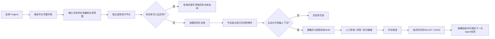

# Argo v0.2.0 要件定义书（日本 IPA 阶段组织）

| 项目 | 内容 |
|---|---|
| 产品 | Argo：独立多机 AI Agent 控制台及个人 RAG 桌面客户端 |
| 与 Star 的关系 | Argo 是独立产品与独立仓库，Star 通过服务端代理和 REST SDK 接入 |
| 主交互 | 一次只设置一个 Agent；目标文件机器与路径隶属；执行机器独立 |
| 目标客户端 | Windows Tauri 2（macOS/Linux 为后续适配目标）；Web 可作为调试入口 |
| 交付标准 | 完整需求/基本设计/详细设计/UT/IT/ST/E2E/运维/WBS/代码和示例 |
| 状态 | 开发基线，未通过 Rust 编译或真实双机与 Vercel 端到端验收 |

## 1. 产品定位与目标

Argo 借鉴希腊神话中阿尔戈号船员分工合作的寓意，但每艘“船”（计算节点）有独立资源；不可向用户展示虚假的统一 RAM/VRAM。Argo 负责 AI Agent 任务派发、目标文件范围表达、执行日志、跨平台输入适配；新增个人 RAG 管理所有经授权采集的 AI 上下文，支持审阅、关联、归档、回用并按需同步到用户的 Vercel 私人 RAG。

## 2. 用户与权限

- 单人本地工作流：运行 Tauri 或浏览器与本地 Controller；Worker 以独立 Token 注册。
- Star 服务端：持有 Admin Token，在自身实现用户、项目、设备 RBAC；不可把密钥发送给前端。
- RAG 端：独立 Bearer Token，保存在 Controller 端环境变量；Vercel API 不接受浏览器直连。
- 操作安全：未经显式勾选，不采集 Agent 上下文；未经人工批准，不对外同步。

## 3. 功能需求

| ID | 功能 | 验收要点 | 优先级 | 当前范围 |
|---|---|---|---|---|
| FR-001 | 六 Agent 单选项卡 | Claude/Codex/Hermes/Orca/MiniMax/Multica 互斥切换 | Must | 有 |
| FR-002 | 各平台专属字段 | Multica Workspace/Project/Issue/Assignee；Orca Repo/Agent | Must | 有（CLI 需现场验证） |
| FR-003 | 用户统一输入 | 标题、指令、模型、RAG 引用和高级项 | Must | 有 |
| FR-004 | 文件目标层级 | 节点 → 仓库别名 → 仓库内相对路径 | Must | 有 |
| FR-005 | 执行节点独立 | 独立展示与选择；仓库写入禁止跨节点偷换 | Must | 有（跨机写回未实现） |
| FR-006 | Rust Worker | 注册、心跳、领取、租约、事件、工件上传 | Must | 继承 v0.1 实现 |
| FR-007 | 文件隔离 | 独立 Git Worktree、相对路径校验、哈希工件 | Must | 部分：不是 OS 沙箱 |
| FR-008 | 个人 RAG 页面 | 关键词、Agent、项目、状态筛选，片段详情 | Must | 有 |
| FR-009 | 分段处理 | Unicode 安全，850 字符窗口、110 字符重叠、最多128片 | Must | 有 |
| FR-010 | 安全脱敏 | 基础令牌模式脱敏，人工复核后外传 | Must | 有基础规则 |
| FR-011 | 归档审核 | draft → approved → synced / archived，版本防并发覆盖 | Must | 有 |
| FR-012 | 知识链接 | related/supersedes/depends_on/derived_from | Should | 有 |
| FR-013 | 同步 Vercel | Controller 对外 HTTPS、服务端 Token、幂等上传 | Must | 有，需远端契约接入 |
| FR-014 | 远端搜索 | 经 Controller 代理查询远端个人 RAG，允许导入本地草稿 | Should | 有 |
| FR-015 | 多 Agent 复用 | 仅主动选择 approved/synced 片段注入提示词，带引用 ID | Must | 有 |
| FR-016 | 来源追踪 | provider、project、task_id、source_key、fingerprint | Must | 有 |
| FR-017 | Star 接口 | REST/TypeScript SDK，接口由 Star 后端代理 | Must | 有 |
| FR-018 | 演示隔离 | `?demo=1` 明示模拟运行、禁止真实云端同步 | Must | 有 |
| FR-019 | 自动向量化 | 入库后可异步生成向量并进行语义检索 | Should | 待接现有 RAG 管线 |
| FR-020 | 异机写回 | 文件在 A、Agent 在 B、经快照/patch 审核后写回 A | Future | 本版本明确禁止直接写 |

## 4. 质量属性

- 可用性：主屏仅要求 Agent、提示词、文件目标、执行位置四项，其他配置折叠。
- 并发：Controller 采用 SQLite WAL；多节点同一任务必须经租约独占；失联任务设 `needs_review`，不盲目重复执行。
- 保密：任务数据不得以无鉴权公开 API 暴露；敏感凭据保留 Worker 或 Controller；审计记录不得包含访问令牌。
- 数据管理：片段来源、状态、版本号可追踪；后端提供 SHA-256 指纹去重；本地保留原始任务结果供人工审核（应根据运维政策设置留存期）。
- 可维护性：Rust Runtime、Tauri 前端、Vercel Gateway、Star SDK 各自独立，统一 OpenAPI。
- 性能基准：本地片段导入 ≤80k 字符，输出至多 128 段；页面列表最多200 条；大库分页/索引优化列入下一迭代。

## 5. 业务流程

## 6. 明确非目标

- 不共享多台 Windows 的物理内存、GPU 显存；不提供无审核跨机文件写回。
- 不能保证所有平台 CLI 版本兼容；Orca/Multica 的派发成功不等于模型任务完成。
- 不声明已经完成 Vercel 个人 RAG 数据库对接；实际域名、认证和 schema 未由用户提供。
- 不自动收集所有历史 AI 聊天；仅采集 Argo 执行的已授权任务，以及人工导入的内容。

## 7. 验收出口

前端 6 Tab、Multica/Orca 专属输入；RAG CRUD/审核/远端网关契约；无隐式上传；跨节点写入被拒绝；UI 快照经设计评审；Rust 编译、真机 CLI、远端 DB 由后续验收完成。
