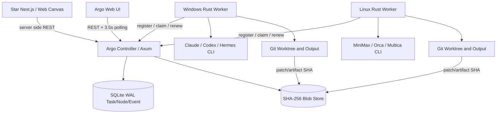
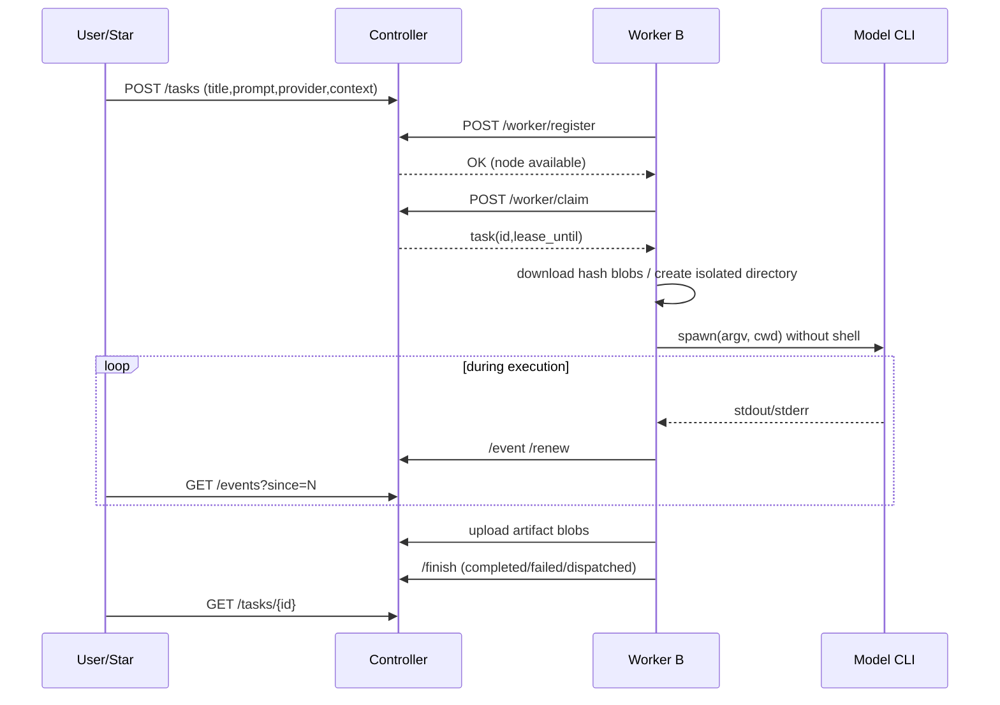

# Argo 基本设计书：系统架构

ID：ARGO-BD-001 · 版本：1.0 · 可维护源图：Mermaid

## 架构原则

**计算在 Worker、状态在 Controller、文件按需传输、Star 只做上层入口。** Controller 负责注册、任务、租约、日志与文件引用；Worker 负责本机 Provider 检测、认证环境、进程运行与工作目录。各机器可运行不同模型；不共享 CPU/GPU 指针，不隐式合并显存。

## 部署拓扑

| 层次 | 进程 | 所有权 | 存储 |
|---|---|---|---|
| Web | `web/index.html` + `app.mjs` | Argo | sessionStorage: 仅临时 Admin Token |
| Controller | `argo-runtime server` | Argo | `argo.sqlite`、`blobs/` |
| Worker | `argo-runtime worker` | 每台电脑本地 | `data/runs/<node>/<task>` |
| Third-party | `claude/codex/hermes/mcode/orca/multica` | 所在电脑 | 第三方本机认证与配置 |
| Integration | Star server action / API proxy | Star | Argo Task ID 映射 |

## 部署与通信顺序

## Controller 子模块

- **Auth**：Admin 与 Worker Bearer Token；首版非多租户。
- **Registry**：每 12 秒注册/心跳，Server 45 秒阈值用于 UI 展示，60 秒阈值用于 claim 准入。
- **Scheduler**：Worker 主动领取；依据 Provider、Repo Alias、固定 Node 与 max_parallel 过滤；CAS 原子 UPDATE。
- **State Store**：SQLite WAL；任务、节点、事件顺序及 Blob 元数据。
- **Blob Store**：本机磁盘，按 SHA-256 命名；未来可迁往 S3 / MiniOS3。
- **Lease Watchdog**：90 秒租约，定期检查；超时标记 needs_review，不自动重复执行有副作用的 CLI。

## Worker 子模块

- **Discovery**：通过 PATH 检查已知六个 CLI，实际可用性取决于登录和运行时。CLI probe 和版本核验需要后续实现。
- **Execution**：Tokio 每节点限制 1~64 个并发；默认 2，任务间目录隔离。
- **Adapter**：分平台生成 argv、判断完成是 `completed` 还是仅 `dispatched`。
- **File Transport**：下载已上传的输入 Blob，验证 SHA-256；执行后上传 Git patch 与显式 `output/` 中的文件。
- **Cancellation**：定期向服务端查询任务状态并终止本地 Child。

## 生命周期与恢复

Controller 可重启并保留 SQLite；Worker 重启会重新注册。首版 Worker 不具备进程重附着：重启时已执行的第三方 CLI 可能成为孤儿进程，应由运维在该节点清理，并人工确认其副作用。租约超时的任务进入 needs_review，必须检查文件/外部系统后再决定是否提交新任务。
