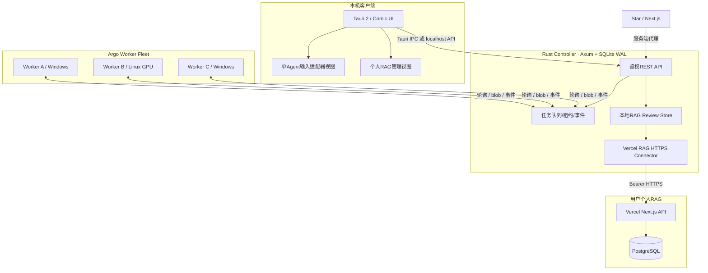

# Argo v0.2 系统基本设计

## 1. 逻辑架构

## 2. 职责与部署

- **Tauri**：展示/校验输入，不持有 Worker / Vercel 密钥。原生 IPC 可请求 Controller。
- **Controller**：身份校验、API、节点注册、任务租约、事件、文件 Blob、本地 RAG 审核与远端连接；SQLite 数据放用户数据目录。
- **Worker**：仅本地允许清单中的仓库，独立 detached Worktree、执行对应 CLI、上传日志/工件；进程启动命令不拼 shell 字符串。
- **Star**：对 Argo API 的上层场景映射与可视化，不直接读取本地物理磁盘。
- **Vercel**：无状态接收/搜索 API；PostgreSQL 持久化，向量化由独立已配置 RAG 模块负责。

## 3. 数据流分层

A) 命令流：前端→Controller→Worker；B) 文件流：sha256 Blob、附件和 Git patch；C) 知识流：任务输入/输出（主动采集）→脱敏→RAG 本地草稿→审核→Vercel；D) 检索流：本地 approved/synced + 可选远端搜索→按需引用进下一任务。

## 4. 可靠性与安全

- Worker 心跳 + 90s 租约，丢失后标记 needs_review；不得自动重放有外部副作用的任务。
- Admin Token、Worker Token 和 Vercel Token 应独立；正式部署须 TLS、防反向代理泄漏、审计与备份。
- 协议中 `file_owner` 与 `target_node` 分离表达；存在 repo 写入时必须相同，异机写回需未来审批同步协议。
- 未启用 OS 沙箱的 Claude/Hermes/Orca 等不得被宣传为强沙箱；Git Worktree 仅隔离版本工作目录。

## 5. 技术矩阵

| 部分 | 技术 |
|---|---|
| UI | HTML + CSS + 原生 ES Modules，Tauri 2 封装 |
| Controller / Worker | Rust，Tokio，Axum，reqwest，SQLx |
| 本地元数据 | SQLite WAL |
| 任务附件 | SHA-256 文件对象 |
| 远端入库 | HTTPS JSON API → Vercel Route Handler → PostgreSQL |
| 语义检索 | 由用户现有 RAG 的向量化管线或后续 pgvector Worker 承担 |
