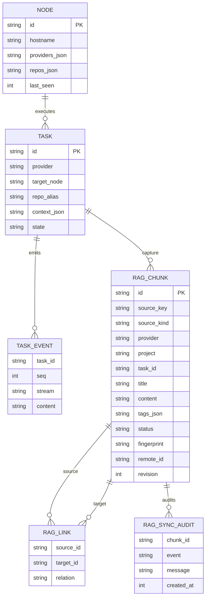

# Argo 数据模型与 RAG 基本设计

## ER（Mermaid 源，可维护）



## 状态与事务规则

`draft` 可编辑、可归档；`approved` 可供任务引用及请求远端同步；`synced` 已收到远端 2xx 回执；`archived` 退出召回。编辑任意内容/标题/标签时回到 draft，清除旧远端引用并要求重新审核。`revision` 用于乐观锁（PATCH 必填）；`fingerprint` 目前按 `provider/project/source_key/chunk content` SHA-256 去重。

## 入库消息结构

```json
{
  "id":"rag-1234567890abcdef12345678",
  "source_key":"task:UUID",
  "source_kind":"agent_run",
  "provider":"codex",
  "project":"Star",
  "title":"接口检查 · 1",
  "content":"已审核的上下文文本",
  "tags":["架构","后端"],
  "fingerprint":"64位sha256",
  "revision":1
}
```

## 一致性策略

本地审批是权威状态，远端持久化成功后才标记 synced；HTTP 失败保留 approved 供人工重试，重试采用 fingerprint 幂等键。远端返回 2xx 后本地事务若冲突，会返回 `concurrent_change_after_remote_commit`，需要人工核查；生产应增加 Outbox 和远端版本对账。

## 可检索对象

本地仅检索 `approved` / `synced` 且按 provider/project 过滤；远端示例提供关键词搜索，向量能力未实现。RAG 文本不作为系统提示词，引用时用 `[Argo-RAG:id]` 并明确是参考资料。
