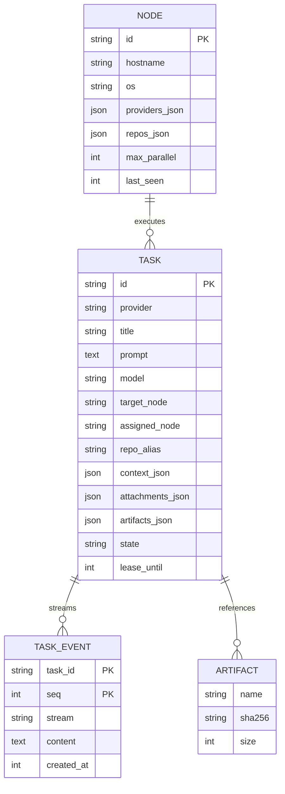
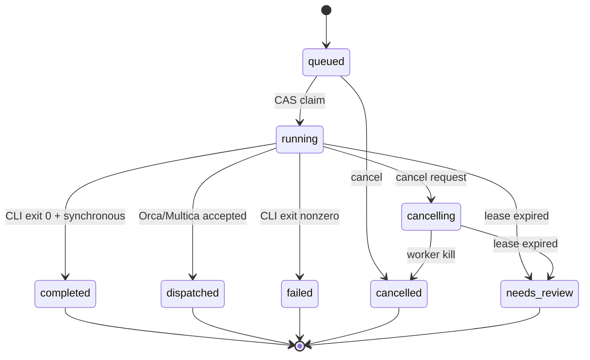

# Argo 基本设计：数据模型与 REST API

ID：ARGO-BD-002 · 版本：1.0

## ER 图



注：Artifact 当前是 `TASK.artifacts_json` 中的 JSON 数组，并非独立 SQL 表；图表示业务关系而不是一比一物理表。

## Task 状态迁移



`dispatched` != 下游 Agent 已完成。无法自动保证 Orca/Multica 后续是否执行成功，应由下游平台各自的运行状态 API 补充二期双向同步。

## REST API（v1）

| Method | Path | 角色 | 含义 |
|---|---|---|---|
| GET | `/health` | 公共 | 心跳，无机密 |
| GET | `/api/v1/providers` | Admin | Provider 契约摘要 |
| GET | `/api/v1/nodes` | Admin | 节点注册数据 |
| GET/POST | `/api/v1/tasks` | Admin | 列表 / 新建任务 |
| GET | `/api/v1/tasks/{id}` | Admin | 单任务详情 |
| GET | `/api/v1/tasks/{id}/events?since=N` | Admin | 增量事件读取 |
| POST | `/api/v1/tasks/{id}/cancel` | Admin | 取消请求 |
| POST | `/api/v1/blobs` | Admin/Worker | 上传原始二进制文件（10MiB） |
| GET | `/api/v1/blobs/{sha}` | Admin/Worker | 按哈希读取 |
| POST | `/api/v1/worker/register` | Worker | 注册/心跳 |
| POST | `/api/v1/worker/claim` | Worker | CAS 获取任务 |
| POST | `/api/v1/worker/tasks/{id}/event` | Worker | 回传日志 |
| POST | `/api/v1/worker/tasks/{id}/artifact` | Worker | 注册任务输出文件 |
| POST | `/api/v1/worker/tasks/{id}/renew` | Worker | 延长租约 |
| POST | `/api/v1/worker/tasks/{id}/state` | Worker | 获取取消状态 |
| POST | `/api/v1/worker/tasks/{id}/finish` | Worker | 结果终态 |

所有 JSON 接口需 `Authorization: Bearer <token>`，`/health` 除外；浏览器上传 Blob 时用 `application/octet-stream`。错误返回 HTTP 4xx/5xx 与简短消息。具体结构见 `examples/openapi.yaml`。

## 统一提交契约

```json
{
  "title": "检查登录模块",
  "prompt": "审核代码并运行测试",
  "provider": "codex",
  "model": "gpt-6",
  "target_node": "win-gpu-02",
  "repo_alias": "star",
  "context": {},
  "attachments": [{"name":"spec.md","sha256":"64位十六进制哈希"}]
}
```

`repo_alias` 是 Worker 本地 allowlist 的逻辑别名，不是用户任意文件路径。`target_node=null` 表示自动匹配。`context` 由每个 Provider 专属 schema 校验。

## 版本兼容原则

- REST 路由固定 `/api/v1`；添加可选字段须保持旧客户端兼容。
- CLI 版本升级可导致 argv 变化，必须通过适配器 UT/IT 回归验证。
- 多个 Controller 实例不能直接使用同一台机器本地 SQLite 文件并声称高可用；后续应切换 Postgres、对象存储与消息队列。
