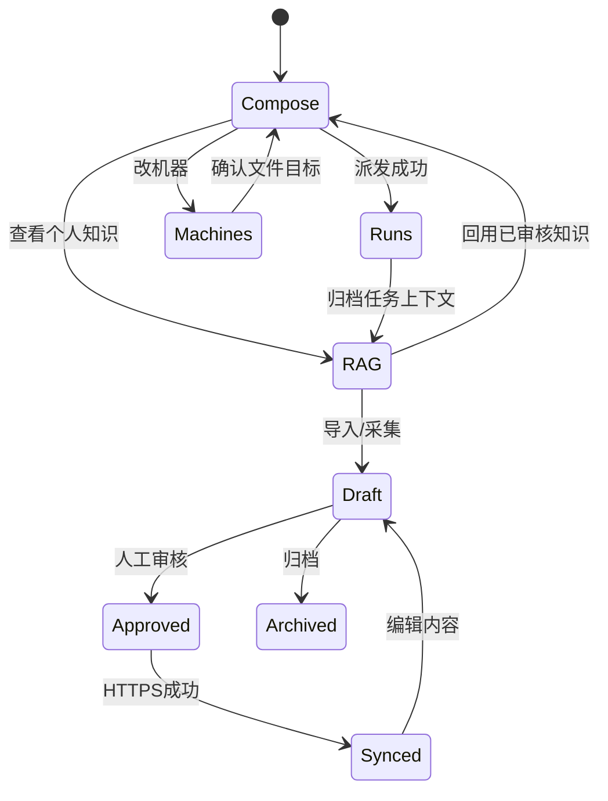

# 前端页面和业务状态基本设计

| 页面 | 主要任务 | 默认显示 | 次要内容 |
|---|---|---|---|
| 执行任务 | 选一个Agent + 指令 + 文件目标 + 执行机器 | 六Tab、平台必要字段、两级机器信息、Execute | 模型、标题、上下文采集、文件管理高级能力 |
| 任务记录 | 定位运行与回执 | 任务/Agent/节点/状态 | 详细日志、工件、允许采集的任务归档 |
| 个人 RAG | 找、审、链、归档、回用 | 状态导航、搜索、Agent/项目筛选、右侧片段详情 | Vercel 远程检索、入库配置等 |
| 机器与集群 | 发现资源、仓库映射 | 在线节点卡 | CLI 健康、额度及细分配置 |
| 设置 | 控制面/密钥/远端状态 | 本机 Token，环境变量说明 | 高级部署 |

## UI 状态机

## 输入平台差异

Orca 负责 Worktree + Agent，Multica 使用 Issue/Project，不以“CLI 返回成功”替代“Agent 执行完成”。具体命令模板由 Rust `model.rs` 负责生成并由 Worker 安全启动；版本兼容需要在目标节点自检。
