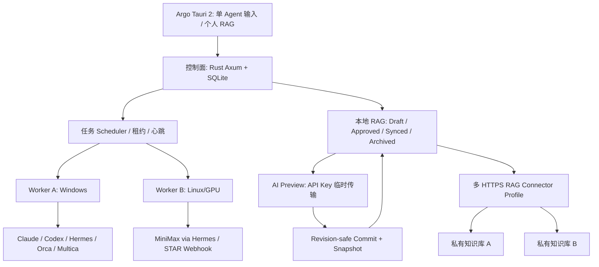

# 基本设计：七 Agent + 个人 RAG 信息架构

## 页面与分层

1. 顶部应用头：项目、集群状态（不绘制大型古船图片）。
2. 任务页：七平台标签，当前平台专属字段与 Prompt 为焦点。
3. 目标文件：机器为父级，仓库和路径为子级；执行节点单独布局。
4. RAG 页：默认仅搜索/列表/详情/审核；「AI 智能整理」和连接设置折叠。
5. 系统设置：控制面验证与通用 RAG 连接器选择（不显示供应商）。

## 概念数据实体

`Task 1--1 Provider`, `Task -> Node(executor)`, `Task -> Repo(fileOwner,alias,scope)`, `Task -> RAGContextRefs`, `RAGChunk -> RAGRevision(0..N)`, `RAGChunk -> RAGLinks(0..N)`, `RAGChunk -> ConnectorProfile(remote_id)`. 每次变更使用 revision CAS 防止并发覆盖。
