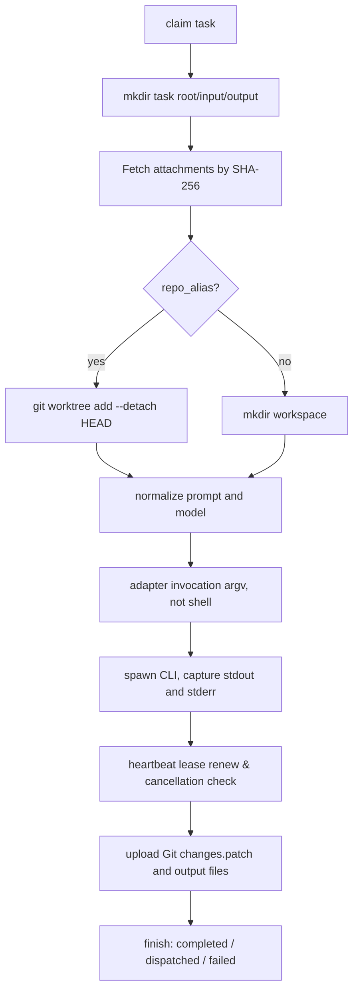

# Argo 详细设计：Rust Daemon、调度与状态机

ID：ARGO-DD-001 · 版本：1.0

## 源码映射

- `crates/argo/src/main.rs`：单二进制 `server` / `worker` 子命令，环境变量加载。
- `model.rs`：序列化模型、平台专属字段校验、纯函数 `invocation` 生成 argv、适配器 UT。
- `server.rs`：HTTP 控制面、SQLite 迁移、任务存取、CAS 领取、文件上传、事件与租约。
- `worker.rs`：运行时发现、节点注册、并发执行、仓库 Worktree、Agent 执行、结果回传。

## 1. Worker 启动

1. 读取 `ARGO_SERVER`、`ARGO_NODE_ID`、`ARGO_WORKER_TOKEN`、`ARGO_MAX_PARALLEL`。
2. 读取 `ARGO_REPOS` 的 alias=absolute-path allowlist（分号分隔），仅保留可访问的目录。
3. PATH 检测 `claude/codex/hermes/orca/mcode/multica`；检测仅表明可执行文件存在，不证明已经登录。
4. POST `/worker/register`，包含 id、hostname、OS、providers、repos、max_parallel，每隔约 12 秒重复。
5. 有空闲 `Semaphore` 许可时 POST `/worker/claim`，无任务睡眠 2 秒再继续。

## 2. 选择节点与 CAS

控制面从 `state='queued'` 的任务依创建时间顺序查找不超过 100 个候选：

```text
eligible(task, node) =
  node.last_seen > now - 60s
  AND task.provider IN node.providers
  AND (task.target_node IS NULL OR task.target_node = node.id)
  AND (task.repo_alias IS NULL OR task.repo_alias IN node.repos)
  AND count(node.running, node.cancelling) < node.max_parallel
```

符合条件时执行原子 SQL：

```sql
UPDATE tasks
SET state='running', assigned_node=?, started_at=?, lease_until=?
WHERE id=? AND state='queued';
```

`rows_affected=1` 即领取成功。两个 Worker 并发领取只有一个能够成功；对多 Controller + 共享 SQLite 的性能上限，MVP 不作高可用承诺。

## 3. 任务运行与文件生命周期



每次任务目录：`ARGO_RUNS_DIR/<node-id>/<task-id>/{input,output,workspace,prompt.md}`。`repo_alias` 在 Worker 本地解析，不允许远端指定任意绝对路径。附加资料存放 `input`，文件名禁止路径分隔符，下载后再算 SHA-256。输出不自动回写主分支；Git tracked changes 以 `git diff HEAD --binary` 上传，未跟踪文件必须复制至 `output` 目录才会作为 Artifact 回传。

## 4. 状态与租约

- 领取后租约 `lease_until = now + 90s`。
- Worker 执行期间每 10 秒续约、查询取消状态。
- Controller 定期扫描超过租约且仍为 running/cancelling 的任务并转为 needs_review。
- 不自动重排 lease 超时任务，因为第三方 Agent 可能已经写入 Git 或创建了外部 Issue；自动重跑会造成重复副作用。
- 用户取消 queued 立即 cancelled；取消 running 改为 cancelling，Worker 发现后终止进程并回报 cancelled。若 Worker 已失联，只能等待租约超时标记 needs_review。

## 5. 错误/失败设计

| 故障 | 表现 | 处置 |
|---|---|---|
| CLI 不在 PATH | `spawn` 失败 | failed + system 日志 |
| Provider 认证失败 | CLI 非零退出 | failed + stderr |
| Git 不是有效仓库 | worktree add 非零 | failed；不执行模型 |
| 下载文件哈希错误 | SHA 不匹配 | failed；不运行 CLI |
| 网络/Controller 断联 | event/renew 失败 | 租约到期后 needs_review；人工检查现场 |
| 用户取消执行 | 10 秒轮询发现 | kill Child、cancelled |
| 多节点重复抢占 | CAS rows=0 | 继续领取下一条 |
| Artifact 上传失败 | system 日志 | 不隐瞒，可能仍 completed；人工检查 |

## 6. 未来优化

MVP 轮询与 SQLite 足够验证两机至小规模节点；规模扩张后引入 PostgreSQL、队列、按节点 mTLS、增量同步层和资源指标。并发数并不等于物理显存可保证的任务数；资源调度仍需 GPU 显存预留和 OOM 保护。
