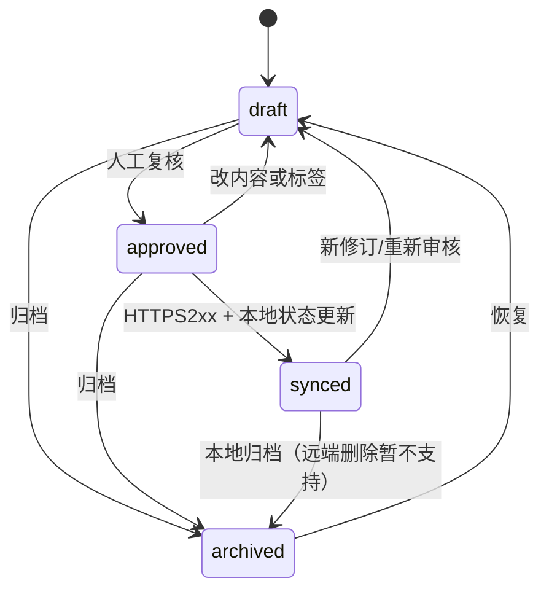

# RAG 详细设计：采集、分段、筛选、归档与链接

## 算法（Rust `rag.rs` / JS `rag.lib.mjs`）

1. 接受人工导入正文或 `rag_capture=true` 的任务输入/输出；校验来源字段、≤80k Unicode 字符。
2. 使用保守基础规则替换已知 token 特征为 `[REDACTED]`，**不足以代替人工涉密审查**。
3. 转 Unicode scalar 字符序列；窗口上限 850、重叠 110；优先查找后半段的换行、句号/问号/感叹号；最多 128 片。
4. 每片 SHA-256(`provider\0project\0source_key\0content`) 生成确定 ID；数据库 `INSERT OR IGNORE` 实现重复提交去重。
5. 默认 draft。支持编辑内容（内容变化后清除 remote_id）、改标题标签、状态流转、按 provider/project/status/内容筛选。
6. 关联同库其他片段，关系枚举 `related` / `supersedes` / `depends_on` / `derived_from`；禁止自己引用自己。
7. 只从 approved/synced 中召回，最多20条。前端一次最多主动挑5条拼接为独立“引用上下文”块，带 `[Argo-RAG:id]`。

## 片段状态转移

## 前端用户故事

- 搜索“任务调度”，选择 Codex 来源 + Star 项目 + draft，查看片段来源后修订、批准。
- 将 Multica 的任务卡约束链接到 Orca Worktree 的设计片段（`related`）。
- 执行新 Agent 前点击“引用 RAG”，只选择 approved/synced 条目，任务提交时保留原始内容与来源标签。
- 点击“检索云端”，由 Rust Controller 发送查询到 Vercel Search API，把结果保存回本地草稿待人工审核。

## 复杂性边界

目前分段以字符数和标点为依据，不使用模型自动语义分段；本地筛选为关键词匹配，不承诺语义准确率；千万条知识和百万级向量检索应交给远端向量引擎处理。
