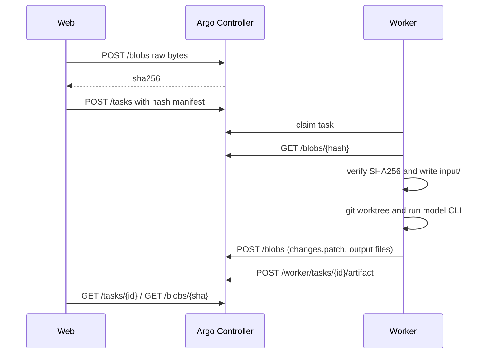

# Argo 详细设计：文件同步、权限与安全

ID：ARGO-DD-003 · 版本：1.0

## 文件输入协议

1. UI 接受 1~20 个附件，每个最多 10MiB，禁止重名与路径分隔符。
2. 对每个文件 POST 原始 bytes 到 `/api/v1/blobs`；Controller 计算 SHA-256 并存储在 `data/blobs/<hash>`，重复内容自然去重。
3. UI 仅将 `{name, sha256}` 列表放入任务 JSON。Worker 领取后凭 Worker Token 下载，重新计算 SHA-256，失败拒绝执行。
4. 文件写入唯一任务目录 `input/`，不覆盖系统文件和主 Git 仓库。对普通 CLI 在 Prompt 末尾附加输入路径说明。

## 文件输出协议

- 对配置 repo_alias 的 CLI 任务建立独立 Git Worktree；运行结束后以 `git diff HEAD --binary` 生成 `changes.patch`（仅 Git 跟踪文件，包含 staged 和 unstaged 的差异）。
- 由 Agent 明确放入 `<task-root>/output/` 的文件，按文件逐个上传 Blob，并将其名字、大小、哈希登记到 `Task.artifacts_json`。
- 首版仅扫描 output 根目录（不递归）；单任务上限 20 个 Artifact，单个 10MiB。系统不隐式扫描电脑其他目录，也不保证捕获所有 Agent 生成的任意文件。
- 后续版本可引入 Git packfile、rsync 风格块差分、S3/MiniOS3 对象存储或预签名 URL。当前只有内容寻址去重，不是通用双向文件系统。

## 安全威胁与控制措施

| 威胁 | MVP 控制 | 剩余风险 / 正式上线门槛 |
|---|---|---|
| Shell 注入 | `Command::args` 单独 argv，无拼接命令 | CLI 的内部 shell 工具仍可能执行代码；强 OS 沙箱尚缺 |
| 路径穿越 | 文件名仅 basename、哈希 hex、仓库映射 allowlist | symlink/特殊文件需做强化安全测试 |
| 凭据泄露 | Worker 侧持有第三方认证、控制面双 Token | Worker Token 是共享权限；生产应改每节点证书和任务授权 |
| 不可信 Prompt | 输入作为数据 argv/文件传入 CLI | Agent 自行执行工具不可认为可信；建议容器或 VM 隔离 |
| Git 代码冲突 | 每任务 detached Worktree、结果差异单独审核 | 仍需 MAGOS/Git 检查冲突后集成 |
| 重复派发 | SQLite CAS、租约与 needs_review | Controller 重启/Worker 孤儿进程仍需人工确认 |
| 传输窃听 | 建议 TLS、Tailscale/反向代理 | 当前 Rust 内置监听不自动启用 TLS |
| API 暴露 | 默认 127.0.0.1 / Bearer | 当前未实现多用户 RBAC、审计日志脱敏、速率限制 |
| 服务端资源耗尽 | 单文件 10MiB、任务结果长度限制、列表限额 | 还需整体用户配额/清理策略/垃圾回收 |

## 明确禁止宣传的能力

Argo 不会让 OS 将两台电脑显存自动识别为一个 VRAM，不能直接把第三方模型实例的 GPU 权重自动跨机器切分。它完成的是多机任务调度与必要资料交换；同一大模型跨机运行需单独引入 Tensor Parallel 等推理引擎。
