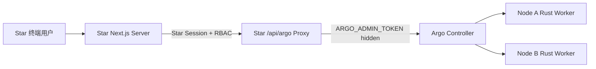

# Star ↔ Argo 集成设计

ID：ARGO-INT-001 · 版本：1.0

## 独立边界

Argo 必须保持一个单独 Git 仓库、单独版本号、单独部署流水线。Star 不直接读取 Argo SQLite，也不承载 Agent 进程；Star 只保存 Argo task ID 与 Star 的 Feature/Sprint/Ticket/Card ID 关联，并消费 Argo API 的状态。Argo UI 可单独访问，Star 无需复制其源文件。

## 推荐部署

第一版 Argo API 的 Admin Token 权限过大，**严禁**直接在浏览器 `NEXT_PUBLIC_*` 下暴露，Star 在自己的服务端完成用户登录、项目成员权限及 Ticket 可访问性审查，再由服务端附加 Admin Token 转发。Star 对任务输入及返回日志应二次核验租户权限，防止不同 Star 用户互相阅读。

## 逻辑数据映射

| Star 字段 | Argo 字段 | 备注 |
|---|---|---|
| `ticket.id` | `external_ref.star_ticket_id`（Star 保存本地关联） | Argo MVP 不持久化外部关联字段；优先由 Star 自己保存 |
| `worktree_repo_alias` | `repo_alias` | 两端命名须一致；Worker 映射成本机路径 |
| `assigned_agent` | `provider` + `context` | 平台适配器专属字段 |
| `node_hint` | `target_node` | null 表示自动调度 |
| `ticket.requirements` | `prompt` | 对 Prompt 进行长度上限和敏感信息校验 |
| `argo.task.id` | `task_id` | Star DB 记录一对多 |
| `argo.task.state` | `run_state` | Star 卡片只展示 `dispatched`，不能当成 completed |
| `argo.artifacts` | review links | 下载补丁后进入 MAGOS 统一审查与合并 |

## Star 工作流

1. Star 用户在 Ticket/Feature 面板点击「交给 Argo」。
2. Star 服务端校验能否写入对应 Ticket；获取被允许的节点/Repo 选择列表。
3. UI 使用相同字段模式提交 `title/prompt/provider/context/repo_alias/target_node`，由 Star Server Proxy 调用 Argo。
4. Star 保存 `ticket_id ↔ argo_task_id`；以请求轮询或服务端订阅（未来）刷新状态。
5. 当 Argo 返回 completed 时展示补丁、测试日志与审查入口；当 dispatched 时展示 Orca/Multica 已受理，等待该平台独立执行状态的后续补充。
6. 由用户、Star 或 MAGOS 流程审核后再合并到受保护分支。

## Star 服务端 API 例子

详见 `examples/star-integration/argo-client.ts`。范例只负责服务端 REST 调用，不附带可能绕过 Star 认证的开放 Proxy Route。需要 Star 工程实现自身 SSO 与 Ticket RBAC 后调用客户端库。

## 版本契约

对接 `/api/v1`，请求体与响应字段通过 OpenAPI 描述。Argo 项目自行发布 Release；Star 每次升级需要进行 `ST-011` 权限联动测试。未来增加 OpenTelemetry trace_id、Provider 原生 run_id、Webhook 与 SSE 时，应保留 v1 的兼容窗口。
