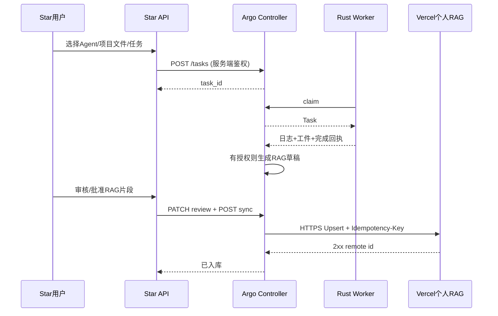

# Star × Argo 独立项目接入设计

- Star 仍管理项目、任务卡、无限画布和协作；Argo 管理 Agent Runtime、Worker 舰队和个人上下文。
- Star Next.js 服务端代理使用 `examples/star-integration/argo-client.ts`；API Token 始终保存在服务端。
- 页面路径建议：`/workspace/:id/argo` Agent 执行面板、`/workspace/:id/knowledge` 嵌入/跳转个人 RAG；独立启动时依然有 Argo 原生 Tauri UI。
- 映射：Star Task ID ↔ Argo Task ID ↔ RAG source_key；只通过服务端授权请求，不能让任何用户跨项目查看其他人的知识/仓库。
- 给 Star 展示的 WebView/iframe 不建议携带 Admin Token；采用 Star 自身 API 受控代理和短期执行会话。
- 建议新增：`listArgoRagChunks`、`ingestArgoRag`、`reviewArgoRagChunk`、`syncArgoRag`、`remoteSearchArgoRag`；这些是 server-only SDK。

## Mermaid

