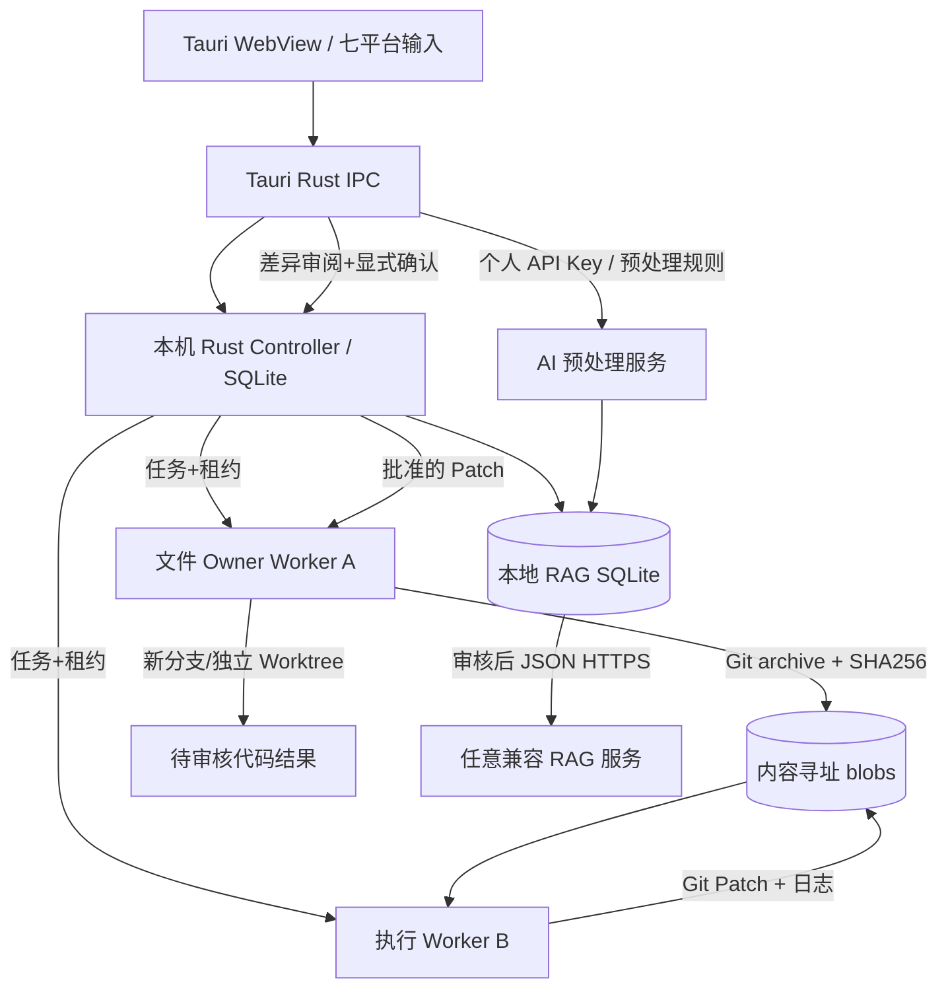

# Argo 0.4 — 增补要件定义与基本设计（IPA 阶段区分）

## 1. 要件定义

### 1.1 目标与系统边界

提供 **Rust + Tauri 2** 独立桌面产品，能够连接用户控制的多台计算机，单一界面选择不同 Agent，决定修改哪台机器的 Git 文件，并可把 Agent 执行放在另一台机器。个人 RAG 按用户控制的外部服务提供商接口连接，不在前端使用任何特定云品牌。

### 1.2 功能需求

| 编号 | 必要功能 | 约束 / 验收要点 |
|---|---|---|
| FR-01 | 七平台 Tab | Claude、Codex、Hermes、Orca、MiniMax、Multica、STAR(问号)；每次只展示当前 Agent 必要输入 |
| FR-02 | 平台输入契约 | CLI 类映射实际参数；Multica 使用 Workspace/Project/Issue；Orca 使用 Worktree/分支；STAR Webhook 可配置 |
| FR-03 | 文件归属 | 文件机器、仓库与文件范围一体化选择；目标执行节点另外选择；不可从路径推断执行节点 |
| FR-04 | 集群任务 | Token 鉴权、节点注册/心跳、可见并发、幂等任务领取、租约与人工恢复 |
| FR-05 | 跨机文件 | Owner 按授权范围制作 git archive，Executor 隔离工作区，SHA-256 存储、人工 Diff 审核和回原机器独立 Worktree |
| FR-06 | 桌面化 | Tauri 启动/关闭本机 Controller 与 Worker；用户无需分开运行本机两套服务；安装时自动捆绑 sidecar |
| FR-07 | 用户设置 | 本地仓库映射、独立节点身份、连接器地址和凭据保存在 Rust 配置文件，不通过 UI 返回凭据 |
| FR-08 | 个人 RAG | 多 Agent 输入/输出经授权采集、切块、筛选、去重、标签、归档、审核、版本、关系、外部同步与检索 |
| FR-09 | AI 预处理 | 用户临时输入 Key、模型和通用规则，逐批预览、明确确认、保存历史、重审后同步 |
| FR-10 | 独立对接 STAR | 不依赖 STAR 服务端作为 Argo 自身运行条件；通过认证 webhook 接口派发并单独记录 ack 与最终状态 |

### 1.3 非功能要求

- NFR-01：Tauri UI 的主输入区仅一平台，占据视觉焦点；复杂设定收进折叠区；无顶部长船插画。
- NFR-02：普通文件传输以源端 Git archive + SHA-256 内容寻址为基线；大仓库由用户收窄范围，不实现共享 RAM/VRAM。
- NFR-03：默认 Controller 只监听 loopback；远程访问经 VPN/TLS；Token 长度与 Admin/Worker 分离。
- NFR-04：未授权文件不可跨作用域写回。应用审批是人机交互、哈希约束和 Git 独立工作树的组合。
- NFR-05：用户 API Key 和连接器凭据不得出现在 UI 列表、普通 task event 中；对模型转发的数据应有显式授权。
- NFR-06：Windows/Linux/macOS 桌面构建以 Tauri 官方支持环境为目标；未完成多系统实测。

## 2. 基本设计

### 2.1 数据模型（增量）

`tasks` 增加：`file_owner_node`、`source_state`、`source_sha`、`source_commit`、`apply_state`、`apply_sha`、`apply_result`；由 SQLite 启动迁移自行添加，与 0.3 已有库兼容。Owner 工程源位于配置的 Git checkout；临时 blob 在 Controller `data_dir/blobs/<sha>`；Runner 输出只在独立工作区。记忆表与历史版本表沿用 v0.3 的迁移定义。

### 2.2 UI 信息层级

第一层：Agent Tab、任务输入、文件归属机器与目录、执行按钮。第二层：平台必须字段、执行节点选择。第三层：权限、模型参数、同步策略、高级 RAG 与任务 Diff。个人 RAG 是独立页面，不在执行页叠加全库编辑。

### 2.3 外部依赖（清楚区分）

STAR 未发布：只实现用户配置的 webhook 接口，不生成虚构 CLI。MiniMax 使用 Hermes 模型适配，不冒充正式 MiniMax 专用 CLI；所有 Agent 均要求用户自行安装并认证。RAG 连接器仅支持约定的 HTTPS JSON 请求，不会自动兼容所有提供商独特接口。
