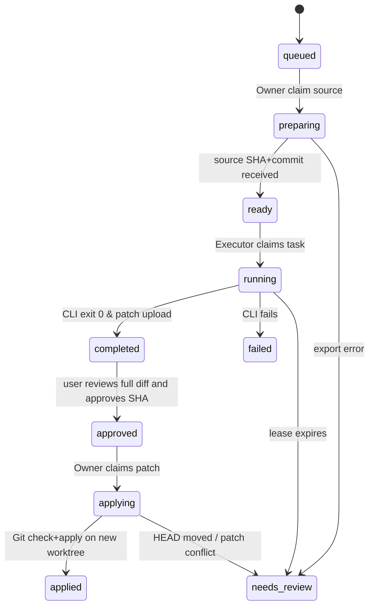

# Argo 0.4 — 双机部署、文件同步与写回详细设计

## 1. 控制服务

1. 选一台受信任的控制机器运行 `argo-runtime server`，设置互不相同且 >=24 字符的 `ARGO_ADMIN_TOKEN`、`ARGO_WORKER_TOKEN`；服务默认只绑定 `127.0.0.1:8788`，需要跨机时通过 VPN/TLS 将 API 安全暴露给节点。
2. 其他机器安装相同版本的 `argo-runtime worker` 并配置 `ARGO_SERVER=https://controller.internal`、`ARGO_WORKER_TOKEN`、`ARGO_NODE_ID`、`ARGO_REPOS=alias=/abs/repo/path;alias2=...`。Windows 中使用 PowerShell `$env:...`。Node ID 在集群中必须唯一。
3. 本机 Tauri 程序走自动 sidecar；第一版暂不提供跨设备节点自动配对/PKI，跨设备 Worker 的 Token 与 VPN 配置由用户手动完成。

## 2. 本地运行（PowerShell 示例）

```powershell
$env:ARGO_ADMIN_TOKEN  = 'replace-with-very-long-admin-secret-12345'
$env:ARGO_WORKER_TOKEN = 'replace-with-different-worker-secret-67890'
$env:ARGO_BIND = '127.0.0.1:8788'
$env:ARGO_DATA_DIR = '.\data'
cargo run -p argo-runtime -- server
```

另一个终端：

```powershell
$env:ARGO_SERVER = 'http://127.0.0.1:8788'
$env:ARGO_WORKER_TOKEN = 'replace-with-different-worker-secret-67890'
$env:ARGO_NODE_ID = 'dev-01'
$env:ARGO_REPOS = 'argo=D:\Projects\Argo'
cargo run -p argo-runtime -- worker
```

在机器 B 上将 `ARGO_NODE_ID='gpu-02'`，`ARGO_REPOS` 可以为空，但 `ARGO_SERVER` 必须指向同一控制服务（经加密通道）。**Tauri 自动启动的本机 Controller 在 loopback 上，不等于已自动具备公网多机访问能力。**

## 3. 任务状态机



实际数据库使用 `tasks.state`、`source_state`、`apply_state` 三个正交状态，图中部分状态为组合表示，并非每个都存在于 `tasks.state` 枚举中。

## 4. 范围保护和数据一致性

- 任务提交需 `repo_alias`、`context.argo_file_owner`、`context.argo_file_scope`、`target_node`；`repo_alias` 必须在源节点注册；路径必须是 Git checkout 内相对路径（不支持 `..`、绝对路径或逃逸）。
- Owner 需拥有干净 Git checkout；源快照从**已提交 HEAD** 制作，且 tar <=40 MiB。未提交的源文件不会进入快照。
- Executor 校验 SHA-256、拒绝 archive 中的 symlink 与目录逃逸；在隔离目录中执行 CLI。CLI 可以自己启动网络和外部进程，**当前隔离仅为工作目录隔离，不是 OS 强沙箱**。
- Agent 结束时 `changes.patch` 作为 artifact 传给控制面；管理员从 `/api/v1/tasks/{id}/diff` 读取完整可视化 Diff（>200 KB 标记截断且 UI 拒绝审核）；审批请求必须显式 `confirm=true`、匹配 artifact SHA。
- Owner 检查 `HEAD` 与快照源 `source_commit` 相等，创建 `argo/review-<task-id>` 分支和新的 Worktree，`git apply --check` 后写入；还要审计修改的全部路径在范围内。发现冲突保留隔离结果待人工修正。
- 没有自动 merge/push；用户必须检查测试后手动集成（可进一步接入 MAGOS）。

## 5. 失联与重试

- 心跳 12 秒、任务租约 90 秒；租约超时变 `needs_review`，**不自动重新执行可能产生外部副作用的命令**。
- 快照准备中进程异常、审批写回中中断同样需人工检查；当前没有专用恢复端点。其他节点获取同一任务要通过 SQLite 条件更新避免重入。
- 文件下载、网络错误、Controller 与 Worker Token 更换需要受控人工恢复。

## 6. 生产安全缺口

Worker 共用凭据而非每节点双向 TLS 身份，未提供远程 shell 系统级沙箱，暂不支持不可信多租户、生产机任意执行。RAG 外发还需审查 DLP 和使用者同意。部署时限制服务网段，网络层 TLS，访问隔离并备份加密凭据和 SQLite。
