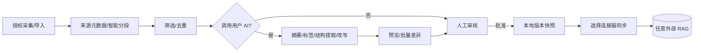

# Argo 0.4 — 通用个人 RAG 与 AI 前处理设计

## 1. 要件

用户可连接多个**自己控制的 RAG 服务**，支持在本地 SQLite 管理来自不同 Agent 的上下文片段，标签、摘要、检索、归档、链接、审核、重用。与具体部署供应商无关；UI 仅展示“RAG 服务”。

## 2. 处理管线



### 2.1 数据

每个片段追踪来源（provider、task_id、project）、title、content、tags、status、hash；版本恢复保留旧状态供审计。跨 Agent 的上下文并不自动读取私人其他应用的全部历史，必须获得用户授权或由 Argo 任务产生。

### 2.2 AI 提示与应用约束

- 用户填写模型服务、Model ID、临时 API Key、统一处理规则；仅传给受信 Controller 再转发到兼容 API。不会在普通任务历史中公开 Key。
- 支持提取标签、做摘要、结构提取和统一改写。模型输出**不是事实来源**，结构化输出需校验与人工审核。
- 大批量每批 8 条；先呈现首批改动预览与目标总量，用户明确确认后连续处理。每条写入保留修订版本、回到待审核。可中止未来批次，已写入部分需从版本历史逐条恢复。
- 没有自动清洗全部秘密的保证。敏感工作文档默认不要发送外部 AI 服务。

### 2.3 通用连接器

Rust 配置示例：

```json
{
  "id": "personal",
  "name": "我的知识库",
  "upsert_url": "https://rag.example.org/api/upsert",
  "search_url": "https://rag.example.org/api/search",
  "token_env": "ARGO_RAG_PERSONAL_TOKEN"
}
```

仅支持**约定的 JSON HTTP 契约**，不能假装任意 RAG 产品即插即用。复杂 API 通过轻量网关转换即可，参考 `docs/03_detailed_design/04_通用RAG连接契约.md`；服务端长期凭据应放入 OS Secret Store/受保护环境，桌面本地配置中只返回连接器元数据，不返回 Token。`examples/vercel-rag-gateway/` 是可选实现例，UI 没有这类供应商文字。

## 3. 测试设计关键案例

| ID | 输入 | 预期 |
|---|---|---|
| RAG-01 | 批量处理 0 条 | 提示需要选择目标 |
| RAG-02 | 全库 300 条 | 分批 8 条调用并显示进度，中断后已有修改保留修订历史 |
| RAG-03 | 批量改写前不点击确认 | 不触发数据库写入 |
| RAG-04 | 已批准记忆重写 | 写入变更但自动回到待审核，不能直接同步 |
| RAG-05 | 不符合 JSON 契约的外部 RAG | 返回可诊断错误、不静默成功 |
| RAG-06 | 未配置 HTTPS 或认证失败 | 阻止连接或返回安全错误 |
| RAG-07 | 前端读取连接器列表 | 不暴露 API Token |
| RAG-08 | 使用临时个人 AI Key | Key 不写入记忆记录或任务日志 |
