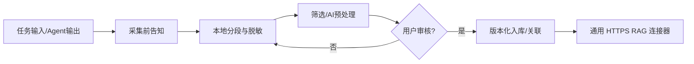

# Argo v0.4 — TypeScript 前端 / Tauri 2 / Rust Daemon 详细设计

版本：0.4.0 ｜ 状态：开发基线 ｜ 目标平台：Windows 11 首发，Linux/macOS 扩展

## 1. 设计决策

- **运行边界**：Tauri 是桌面容器（Rust），WebView 页面使用 TypeScript 源码编译得到的 ES2022 JavaScript。TypeScript 不直接在 WebView 执行，也不替代 Rust 后端。
- **使用轻量 TS + CSS + DOM**：保持既定美漫 3 渲 2、低认知负荷外观，不引入 React/Next.js 等额外框架。打包时 `tsc` 输出标准 ESM，因此生产运行时不需要 Node.js，也无需 Vite。
- **权威状态**：Rust Controller / SQLite 管任务、审查和 RAG 版本；Worker/Daemon 管 CLI、工作目录和文件；前端仅显示/采集输入。
- **API Key**：本机 Controller 的管理员 Token 不下发到 Tauri WebView；个人 AI Key 只随用户主动发起的 AI 预览请求传入 Rust，并不得进入普通日志或数据库。外部 RAG 令牌由本机 Rust 保存和使用。
- **兼容性**：STAR 当前用 `?` 占位，不虚构未发布 CLI；Multica 保留 Workspace / Project / Issue，Orca 保留 Worktree/Agent 上下文；MiniMax 走用户已配置的模型 Runtime。

## 2. 最终代码结构

```text
Argo/
  src/                         # TypeScript 的唯一前端源码
    app.ts                     # 七平台 Tab、RAG / 节点 / 审查界面逻辑
    contracts.ts               # AgentId / TaskCreate / NodeSummary / RagChunk
    lib.ts                     # 平台任务校验、输入转换、转义
    rag.lib.ts                 # 分段、脱敏、引用、范围校验
    native.ts                  # Rust IPC 的类型化入口
  tsconfig.json                # WebView ES2022 编译配置
  tsconfig.contracts.json      # 核心契约 strict:true
  web/                         # Tauri frontendDist；生成的 .js 和静态资源
  src-tauri/                   # Rust Tauri 2 主进程 + sidecar 管理
  crates/argo/                 # Rust Controller/Worker/Agent/RAG
  scripts/prepare-sidecar.mjs  # 编译并按 target triple 放置 Rust sidecar
  scripts/dev-web.mjs          # 开发用 tsc watch 与 Node 静态服务器
  scripts/serve-web.mjs        # 仅供本地预览的零依赖 HTTP 服务
```

**注意**：`web/app.js` 等文件是由 `tsc` 自动生成的构建产物，不应直接编辑；正式开发修改 `src/*.ts`。`src/app.ts` 不使用 `@ts-nocheck`。CLI 校验及 Rust 编译必须单独执行，不能以 TS 通过代替。

## 3. 生命周期（Tauri）

1. `npm run prepare:runtime` 执行 `cargo build -p argo-runtime`，并复制到 `src-tauri/binaries/argo-runtime-<triple>(.exe)`。
2. `tauri dev` 前启动 TypeScript watch 编译及本地静态预览服务；窗口加载 `http://127.0.0.1:8997`。
3. Tauri `setup()` 创建用户应用数据目录，生成本机 Controller/Worker Token，并异步启动 Rust Controller 和 Worker sidecar。
4. 前端通过 `window.__TAURI__.core.invoke('argo_request', ...)` 的类型化包装 `src/native.ts` 访问 Rust API，不直接读取本机管理 Token。
5. 注册本机 Git 仓库后重启 Worker；设置通用 RAG 连接器后重启 Controller/Worker。
6. Tauri 退出时终止由本应用创建的 sidecar 进程；Windows 安装与升级必须另测意外退出、已有监听端口、进程残留。

## 4. 三种互相独立的对象

- **文件目标**：`file_owner_node -> repo_alias -> argo_file_scope`，指代持有版本和可修改路径的机器。
- **实际执行节点**：`target_node`，可与文件归属机器不同；选择 Auto 时由调度器在约束内决定。
- **Agent 输入模式**：`provider` 决定特有上下文结构。平台切换只改变主输入卡，不改变文件目标区的信息层级。

跨机 Git 快照仅用于直接修改代码的 Claude/Codex/Hermes/MiniMax；Orca/Multica/STAR 采用平台编排接口，不模拟不存在的跨机执行能力。跨机补丁由用户审查后，才进入源机器上的新 Git Worktree，且不自动提交/合并原主分支。

## 5. 个人 RAG 工作流



- AI 自动标签、摘要、结构化提取和批量统一改写使用用户自己的兼容接口与临时 API Key。
- 批量处理先预览最多 8 条；需要人工明确确认；修改写入修订历史并恢复 `draft`；旧版可恢复。
- 默认只处理用户显式选择的片段，允许扩大到当前筛选结果/全库，但应在预览中提示数量、影响和可回滚范围。
- 外部知识库不锁定 Vercel，接收端需实现文档中定义的 HTTPS upsert/search 协议并明确认证方式。

## 6. 风险及限制

1. **未验证 Rust/Tauri 编译**：当前环境没有 Rust 工具链；不得称为 Windows 已可安装。
2. **Tauri 本机密钥存储**：目前使用私有应用配置文件；Windows Credential Manager / DPAPI 的 OS 加密是生产化任务。
3. **本机端口占用/假冒服务**：固定 `127.0.0.1:18788` 需加入绑定身份、随机端口、进程健康检查与异常恢复。
4. **跨机执行安全**：外网访问须 VPN/TLS、节点身份隔离、最小权限；不能直接开放未加密 HTTP Worker 通道。
5. **UI 类型精度**：公共契约与纯函数已强制 strict；复杂 DOM 控制逻辑采用显式元素包装和 AppState 接口，后续可逐步细化异步 API 返回类型。
6. **真实适配器兼容**：第三方 CLI 参数可能变化，必须通过实机逐一验证。

## 7. 开发及验证命令

```powershell
npm install
npm run typecheck
npm test
npm run preview        # http://127.0.0.1:8899/?demo=1
npm run dev            # 需要 Rust；Tauri + sidecar
npm run build          # 需要 Rust/Windows 构建链；产出打包目录
```
